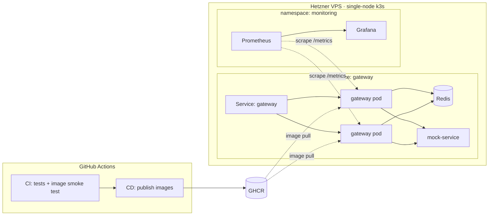
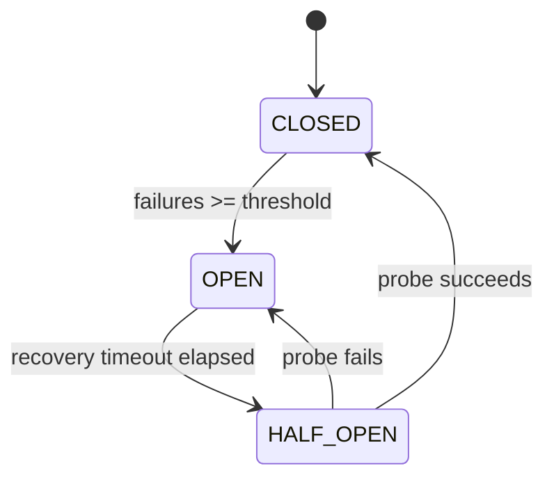

# API Gateway

A reverse-proxy API gateway built with FastAPI, httpx and Redis. It routes
requests by path, rate-limits per client IP, caches responses, checks JWTs and
trips a circuit breaker when a downstream fails. All shared state lives in
Redis, so any number of gateway replicas behave as one.

It runs on a self-managed single-node **k3s** cluster on a Hetzner VPS. GitHub
Actions tests every change, builds the images, starts them the way the cluster
runs them and publishes them to GHCR. **Prometheus + Grafana** track traffic,
errors, latency and breaker state, with alert rules on top. Ingress and TLS
come next (in progress).



## Features

| Feature | How it works |
|---|---|
| Routing | Longest-prefix match on the path; optional prefix stripping; the path is forwarded exactly as the client sent it |
| Rate limiting | Fixed-window counter per client IP and route in Redis (atomic Lua), each route with its own limit or the configured default; temporary bans set and lifted through the admin API |
| Retries | Exponential backoff on timeouts and configurable 5xx codes, for idempotent methods only; any method is retried if the connection never opened |
| Circuit breaker | CLOSED → OPEN → HALF_OPEN per downstream, one outcome per client request, state shared through Redis |
| Response cache | Redis cache for successful GETs, keyed per caller (`Authorization` and `Cookie`); a response with `Set-Cookie` or `Cache-Control: private`, `no-store` or `no-cache` is not stored; TTL from config, invalidation by path pattern via the admin API |
| JWT auth | Bearer tokens, required per route; a token must carry an expiry |
| Observability | JSON logs with a request ID carried end to end; Prometheus metrics at `/metrics`; alert rules |
| Admin API | `/admin/*` to inspect and reset breakers, limits, bans and cache |
| Mock service | Fake downstream with failure injection, for demos and manual testing |

## Project structure

```
.
├── .github/workflows/
│   ├── main.yml               # CI: ruff + pytest, then both images built and run as the pods run them
│   ├── infra.yml              # Infra checks: manifests, Prometheus config and rules, Terraform
│   ├── scan.yml               # Image scan: Trivy, on changes and every week
│   └── cd.yml                 # CD: build both images, push to GHCR, optional deploy
│
├── k8s/                       # Kubernetes manifests, applied in numeric order
│   ├── 00-namespace.yaml
│   ├── 10-redis.yaml          # PVC + Deployment + Service
│   ├── 20-gateway-config.yaml # ConfigMap (the Secret is created on the cluster, not stored here)
│   ├── 30-gateway.yaml        # Deployment (2 replicas, scrape annotations) + Service
│   ├── 40-mock-service.yaml   # Deployment + Service
│   ├── 50-network-policy.yaml # Who may connect to what
│   └── monitoring/            # Prometheus + alert rules, Grafana, dashboard, network policy
│
├── scripts/
│   ├── smoke-test.sh          # Runs the images under the pod constraints, in CI or locally
│   ├── deploy.sh              # Rolls the cluster to one commit's images, with rollback
│   └── configmap_file.py      # Prints one file out of a ConfigMap manifest
│
├── terraform/                 # Earlier AWS target, kept as reference
│
└── gateway/
    ├── main.py                # FastAPI app, lifespan, middleware wiring
    ├── config.yaml            # Route table + all tunable settings
    ├── mock_service.py        # Fake downstream with failure injection
    ├── Dockerfile, Dockerfile.mock, docker-compose.yml
    ├── requirements.txt       # What the images install
    ├── requirements-dev.txt   # The above plus pytest; not installed into the images
    ├── core/                  # Settings loader, JSON logging, Redis client
    ├── services/              # proxy + retry, rate limiter, circuit breaker, cache, auth
    ├── routers/               # proxy catch-all, admin API, /metrics
    ├── utils/                 # Logging middleware (request ID, latency), error responses
    └── tests/test_gateway.py  # 74 unit + integration tests
```

## Quick start

### Docker Compose

```bash
cd gateway
docker compose up --build
```

Gateway on `localhost:8000`, mock service on `localhost:8010`, Redis on
`localhost:6379`. The last two are published on the loopback interface only.

### Local development

`config.yaml` uses the Compose and Kubernetes hostnames `redis` and
`mock-service`. Run those two in Compose and point the names at your machine,
so the same config works everywhere:

```bash
cd gateway
docker compose up -d redis mock-service
echo "127.0.0.1 redis mock-service" | sudo tee -a /etc/hosts   # once
pip install -r requirements.txt
uvicorn main:app --port 8000 --reload --no-proxy-headers
```

### Any Kubernetes cluster

The manifests pull the public images from GHCR, so they work on minikube, k3s or
any other cluster without building anything locally. The one thing they do not
contain is the Secret, which is created on the cluster first:

```bash
kubectl apply -f k8s/00-namespace.yaml
kubectl create secret generic gateway-secret -n gateway \
  --from-literal=JWT_SECRET_KEY="$(openssl rand -hex 32)" \
  --from-literal=REDIS_PASSWORD="$(openssl rand -hex 24)"

kubectl apply -f k8s/
kubectl -n gateway get pods -w
kubectl -n gateway port-forward svc/gateway 8000:8000
```

## Deployment: Hetzner + k3s

| | |
|---|---|
| Server | Hetzner CX23: 2 vCPU, 4 GB RAM, Ubuntu 26.04 LTS |
| Hardening | Non-root user, key-only SSH, root login disabled, UFW allowing 22/80/443 plus the k3s pod and service ranges |
| Kubernetes | k3s, single node; bundles Traefik, CoreDNS and the local-path storage provisioner |
| Images | Pulled straight from public GHCR; no registry credentials on the cluster |

### First deploy

The three steps from "Any Kubernetes cluster": the namespace, the Secret, then
`kubectl apply -f k8s/`. The Secret exists only on the cluster. Applying the
manifests again never touches it, so the keys stay what they were set to.

### Updating

A push to `main` runs CI, then CD publishes `:gateway-<sha>` and `:mock-<sha>`,
plus the moving `:gateway` and `:mock` tags that a first install starts from.
To put a commit on the cluster, on the server:

```bash
scripts/deploy.sh <sha>     # the first 7 characters of the commit
```

It points both Deployments at that commit's images, waits for the new pods to
pass their readiness probe, and rolls back whichever Deployment does not get
there. Going back to an earlier version is the same command with the earlier SHA.

Changes to the manifests themselves (ConfigMap, probes, policies) still go in
with `kubectl apply -f k8s/`. That also puts the Deployments back on the moving
tags, so run `deploy.sh` after it.

### Automatic deploys (optional)

The `deploy` job in `cd.yml` runs the same script over SSH after each publish.
It stays off until it has been set up:

1. Put the script on the server:
   `sudo install -m 755 scripts/deploy.sh /usr/local/bin/deploy-gateway`
2. Make a key pair for GitHub and allow the public half to run that script and
   nothing else, with a line like this in `~/.ssh/authorized_keys` on the server:

   ```
   restrict,command="/usr/local/bin/deploy-gateway" ssh-ed25519 AAAA... github-actions-deploy
   ```

   `restrict` turns off terminals and forwarding. `command=` replaces whatever
   the client asks to run and passes it to the script as `SSH_ORIGINAL_COMMAND`,
   so a stolen key can roll the two Deployments to a published commit and do
   nothing more. The script accepts 7 hex characters and nothing else.
3. In the repository settings, add the secrets `DEPLOY_SSH_KEY` (the private
   half), `DEPLOY_TARGET` (`user@host`) and `DEPLOY_KNOWN_HOSTS` (the output of
   `ssh-keyscan -t ed25519 <host>`), and the variable `DEPLOY_ENABLED` = `true`.

The script runs without a login shell, so `kubectl` has to work there. If it
needs `KUBECONFIG`, set it in the same line:
`command="KUBECONFIG=/home/<user>/.kube/config /usr/local/bin/deploy-gateway"`.

### Kubernetes design notes

- **Liveness and readiness are different endpoints.** `/admin/live` touches
  nothing but the process. `/admin/health` pings Redis and returns 200 even when
  Redis is unreachable, because the gateway serves without it. With liveness on
  the endpoint that waits for Redis, a Redis stall fails the probe, and
  Kubernetes restarts pods that had nothing wrong with them.
- **Every pod is locked down.** A non-root UID, a read-only root filesystem, no
  capabilities, no privilege escalation, and no Kubernetes API token for the
  pods that never call the API. The gateway logs to stdout only.
  `scripts/smoke-test.sh` starts the images under the same constraints with
  Docker, and CI runs it on every change.
- **Network policies deny ingress by default.** Redis and the mock service
  accept connections from gateway pods only, Prometheus from Grafana only, and
  the gateway's port stays open to the cluster. k3s enforces them with its
  built-in controller; a cluster whose network plugin does not implement
  NetworkPolicy ignores them.
- **Redis has a password and a memory cap.** The cap sits below the container's
  memory limit, and only keys with an expiry can be evicted (cache entries and
  counters), so memory pressure cannot close an open breaker.
- **Redis uses `strategy: Recreate`.** A ReadWriteOnce volume mounts on one node
  at a time, so a rolling update would wait forever for the old pod to release it.
- **`subPath` mounts do not hot-reload.** Editing the ConfigMap needs a
  `rollout restart` before the change takes effect.
- **There is no `depends_on`.** Gateway pods can start before Redis is ready;
  they report degraded until it answers, then recover. The system converges
  rather than sequences.
- **Redis persistence is optional here.** AOF is on so the PVC does something,
  but the data is rate-limit counters and cache: losing it costs one window and
  a cold cache. Compose runs Redis with persistence off for that reason.

## Shared state across replicas

Breaker state lives in Redis, so a breaker tripped through one gateway pod is
open on all of them.

```bash
kubectl -n gateway scale deploy/gateway --replicas=4

# Failure mode is in-memory on each mock pod, so set it on every one
for p in $(kubectl -n gateway get pods -l app=mock-service -o name); do
  kubectl -n gateway exec $p -- \
    curl -sX POST "http://localhost:8010/mock/failure-mode?enabled=true&rate=1.0&status=503"
done

# With the port-forward from Quick start running. POSTs skip the cache and aren't
# retried, so each one is exactly one failure (threshold is 5); the 6th is rejected
for i in $(seq 1 6); do
  curl -s -o /dev/null -X POST -H 'Content-Type: application/json' -d '{"name":"demo"}' \
    http://localhost:8000/mock/users
done

# Every replica reports OPEN, including the ones that never saw a failure
for p in $(kubectl -n gateway get pods -l app=gateway -o name); do
  kubectl -n gateway exec $p -- curl -s http://localhost:8000/admin/circuit-breakers
done
```

## Monitoring

The gateway serves Prometheus metrics at `/metrics`:

| Metric | Meaning |
|---|---|
| `http_requests_total{handler,method,status}` | Requests by status class (2xx/4xx/5xx) |
| `http_request_duration_highr_seconds` | Latency histogram, for p50/p95/p99 |
| `gateway_circuit_breaker_state{route,target}` | 0 = CLOSED, 1 = HALF_OPEN, 2 = OPEN |
| `gateway_circuit_breaker_failures{route,target}` | Failed requests counted toward opening |
| `gateway_redis_up` | Whether the replica could read breaker state from Redis |

Breaker gauges are read from Redis at scrape time, so every replica reports the
same shared state. Health probes and scrapes are left out of the HTTP metrics.

`k8s/monitoring/` is sized for the 4 GB node:

- **Prometheus** finds gateway pods by their `prometheus.io/*` annotations and
  scrapes each replica directly rather than through the Service, which would hit
  a random pod each time. Its RBAC is a Role that can only list pods in the
  `gateway` namespace. 15s scrapes, 3 days / 1 GB retention, `emptyDir` storage.
- **Grafana** is provisioned entirely from code: the datasource and an
  *API Gateway* dashboard with request rate, 5xx rate, latency percentiles,
  breaker state per route, Redis status and traffic per replica.

Neither is exposed publicly. Grafana is reached through an SSH tunnel:

```bash
kubectl apply -f k8s/monitoring/00-namespace.yaml
kubectl create secret generic grafana-admin -n monitoring \
  --from-literal=password="$(openssl rand -base64 18)"
kubectl apply -f k8s/monitoring/

# On your PC: tunnel port 3000 to the server
ssh -L 3000:localhost:3000 <user>@<server>
# In that SSH session
kubectl -n monitoring port-forward svc/grafana 3000:3000
# Open http://localhost:3000 and sign in as admin
```

Run the shared-state demo above and the dashboard shows the 5xx rate spike and
the breaker turn red on `/mock`, `/users` and `/orders`. All three routes point
at `mock-service`, and breakers are per downstream, so they share one.

### Alerts

Prometheus evaluates six rules, kept next to its config in
`k8s/monitoring/10-prometheus.yaml` and checked by `promtool` on every change:

| Alert | Fires when |
|---|---|
| `GatewayDown` | No replica has answered a scrape for 2 minutes |
| `GatewayReplicaDown` | One replica has not answered a scrape for 5 minutes |
| `GatewayHighErrorRate` | More than 5% of responses have been 5xx for 5 minutes |
| `GatewayHighLatency` | p95 latency has been above 1 s for 10 minutes |
| `CircuitBreakerOpen` | A downstream's breaker has been open for 2 minutes |
| `GatewayRedisUnreachable` | A replica has been unable to reach Redis for 2 minutes, so it is failing open |

They show on Prometheus's Alerts page
(`kubectl -n monitoring port-forward svc/prometheus 9090:9090`). Nothing
delivers them to anyone yet; see Known limitations.

## Configuration

Everything lives in `gateway/config.yaml`; environment variables override it.
Under Kubernetes the ConfigMap in `k8s/20-gateway-config.yaml` replaces that
file, so keep the two in step. The one intended difference is `logging.file`:
the ConfigMap sets it to `null`, which logs to stdout only.

```yaml
routes:
  - path: "/payments"          # matched by prefix
    target: "http://pay-service:8005"
    rate_limit: 30             # requests per window per IP on this route; default_limit if left out
    strip_prefix: false        # true forwards /payments/invoices as /invoices
    methods: ["GET", "POST"]
    auth_required: true        # require a Bearer JWT

rate_limiting:
  default_limit: 100           # for routes that set no rate_limit
  window_seconds: 60
  ban_duration_seconds: 300    # for a ban requested without a duration

circuit_breaker:
  failure_threshold: 5         # failed requests in a row before OPEN; retries count once
  recovery_timeout_seconds: 30 # time in OPEN before HALF_OPEN
  half_open_max_calls: 3       # probes allowed in HALF_OPEN
```

| Variable | Overrides |
|---|---|
| `REDIS_HOST`, `REDIS_PORT` | Redis address |
| `REDIS_PASSWORD` | Redis password (a Secret under Kubernetes) |
| `JWT_SECRET_KEY` | JWT signing key (a Secret under Kubernetes); at least 32 bytes for HS256. Unset, the gateway signs with a random key that lasts until it restarts, and logs a warning |

Two things that break routes silently:

- `strip_prefix` must match what the downstream serves, or every request 404s.
- `target` is a hostname that must resolve where the gateway runs (a Compose
  service or Kubernetes Service name). Renaming the Service breaks the route.

Rate limits key on the TCP peer address, never on `X-Forwarded-For`, which the
client controls. By default uvicorn trusts that header from 127.0.0.1, which is
where `kubectl port-forward` traffic comes from, so the image runs it with
`--no-proxy-headers`. Behind a load balancer, replace that flag with
`--forwarded-allow-ips=<load balancer address>` so uvicorn trusts the header from
that peer only.

## API reference

```bash
# Get a JWT (demo: any username and password are accepted)
curl -X POST http://localhost:8000/auth/token \
  -H "Content-Type: application/json" -d '{"username": "alice", "password": "any"}'
curl http://localhost:8000/users -H "Authorization: Bearer <token>"

# Proxy through the unauthenticated /mock route
curl http://localhost:8000/mock/users
curl http://localhost:8000/mock/orders
curl "http://localhost:8000/mock/mock/slow?delay=3"   # mock's own helpers sit under its /mock prefix

# Admin
curl http://localhost:8000/admin/live                                  # liveness: the process answers
curl http://localhost:8000/admin/health                                # readiness: also reports Redis
curl http://localhost:8000/admin/routes                                # the route table in effect
curl http://localhost:8000/admin/circuit-breakers
curl -X POST http://localhost:8000/admin/circuit-breakers/reset
curl -X POST http://localhost:8000/admin/circuit-breakers/http%3A%2F%2Fmock-service%3A8010/reset  # one target
curl http://localhost:8000/admin/rate-limit/1.2.3.4                    # counters per route, ban status
curl -X POST http://localhost:8000/admin/rate-limit/1.2.3.4/reset      # clear its counters on every route
curl -X POST "http://localhost:8000/admin/rate-limit/1.2.3.4/ban?duration=600"   # seconds, up to 30 days
curl -X DELETE http://localhost:8000/admin/rate-limit/1.2.3.4/ban      # lift the ban early
curl -X POST "http://localhost:8000/admin/cache/invalidate?pattern=/users*"
curl -X POST "http://localhost:8000/admin/cache/invalidate?pattern=*"  # everything

# Failure injection on the mock service (Compose / local)
curl -X POST "http://localhost:8010/mock/failure-mode?enabled=true&rate=0.7&status=503"
curl -X POST "http://localhost:8010/mock/failure-mode?enabled=false"
```

Response headers:

| Header | Meaning |
|---|---|
| `X-Request-ID` | The client's ID if it sent one of up to 128 letters, digits and `._:-`, else a new UUID; forwarded downstream and logged |
| `X-RateLimit-Limit` / `X-RateLimit-Remaining` | Limit for this route and requests left in the window |
| `X-Response-Time-Ms` | Gateway latency |
| `X-Cache` | `HIT` when served from the cache |
| `Retry-After` | On a 429: seconds until the window ends |

Errors the gateway's own code answers with have one JSON body,
`{"error": "..."}`, with `retry_after` added on a 429. (A malformed request to
one of the gateway's own endpoints gets FastAPI's validation error instead.) A
path containing a `.` or `..` segment is refused with 400: the route's limit,
methods and auth are chosen from the path as sent, and an HTTP client would
collapse `/users/../orders` to `/orders` on the way upstream.

## Tests

```bash
cd gateway
pip install -r requirements-dev.txt
pytest tests/ -v   # 72 passed, 2 skipped
```

Most tests fake Redis in memory, so no infrastructure is needed. Two tests run
the Lua script and the circuit breaker against a real Redis, because a fake
can't run Lua or expire keys. They're skipped unless one is reachable: CI
provides one, and locally `REDIS_HOST=localhost` with Redis running brings the
count to 74.

Coverage: rate limiter (per-route limits and the default, block, ban and unban,
reset, `Retry-After`, fail-open), every breaker transition including recovery
after a quiet period, probe limits and fail-open, proxy forwarding, retries,
retry exhaustion and which methods get retried, one breaker failure per
request, paths forwarded as sent and repeated headers kept, the cache (keys per
caller, binary bodies, responses not meant for sharing, invalidation by path),
JWT create/decode/reject, the Redis client's cooldown after a failure, and
integration tests for the probes, tokens, unknown routes and dot segments,
spoofed `X-Forwarded-For`, request-ID propagation including on a 500,
`/metrics`, bans, per-target breaker reset and a Redis outage.

The images get their own test. `scripts/smoke-test.sh` builds both, starts
Redis, the mock and the gateway with Docker under the constraints the pods have
(UID, read-only filesystem, no capabilities, Redis password, the ConfigMap's
config) and sends a request through all three.

## CI/CD

**CI** runs on every push to `main` or `dev` and on pull requests, in two jobs.
One has a Redis 7 service container for the real-Redis tests, Python 3.12.14
(the same as the image), `ruff` lint, then the test suite. The other lints the
Dockerfiles with `hadolint`, builds both images and runs the smoke test above,
so an image that does not build, or that only works as root, never reaches CD.

**Infra checks** run on the same events but do not gate CD: `kubeconform` in
strict mode over the manifests, `promtool` on the Prometheus config and alert
rules (taken out of their ConfigMap first), and `terraform fmt` and `validate`.

**Image scan** runs Trivy against the gateway image on changes and every
Monday, and fails on HIGH or CRITICAL findings that have a fix. It is on a
schedule because vulnerabilities are published for packages that did not
change, and outside CI so that it cannot turn the release pipeline red with no
commit behind it. Its first run failed on eight such findings, all in Debian
packages that came with the Python base image, which is rebuilt only every few
weeks. The Dockerfiles now install Debian's security updates at build time.

**CD** runs after CI succeeds on a push to `main`, on the exact commit CI tested.
It builds the gateway and mock images and pushes them to GHCR with a moving tag
and a SHA tag, authenticated by the workflow's own `GITHUB_TOKEN`, so no registry
secrets exist. Pull requests never publish. The `workflow_run` branch filter
alone would let one through: it matches the branch the CI run came from, so a
fork's branch named `main` passes it. The job also checks the event and repository.
A second job can then deploy the SHA tag; see "Automatic deploys".

**Pinned versions.** The base image is pinned to `python:3.12.14-slim` and CI
uses the same interpreter, so a rebuild can't change Python underneath the code.
`ruff` is pinned with an explicit rule set in `ruff.toml`, after an unpinned
release turned the build red with no code change. The packages the code
imports are pinned in `requirements.txt`, and so is Starlette, which FastAPI
would otherwise choose; what those pull in beyond that is not. Actions from
outside GitHub are pinned to commit IDs: a tag on someone else's repository can
be moved, and in March 2026 the tags of the scan action used here were. Porting
to Kubernetes also caught a startup crash: the image passed
`--log-config /dev/null`, and `logging.config.fileConfig` rejects an empty
file. It now uses `--no-access-log`.

## Infrastructure as code (AWS, reference)

`terraform/` defines the earlier AWS target: an EC2 instance, an ECR repository,
a security group, an IAM instance profile, a budget alert and a CloudWatch alarm.
The AWS account has been decommissioned, and this configuration was never applied;
`init`, `fmt` and `validate` pass without credentials, and the infra checks run
`fmt` and `validate` on every change.

Two choices worth noting:

- **An instance profile instead of static keys.** The instance gets short-lived
  ECR credentials through the metadata service, with IMDSv2 enforced. That
  matters for a service whose job is proxying requests to URLs.
- **`ignore_changes = [ami]`.** The AMI lookup re-resolves on every plan, so a
  new Ubuntu build would otherwise show as an instance replacement.

## Architecture notes

### Request lifecycle

1. Logging middleware assigns or keeps the request ID
2. A path with a `.` or `..` segment is refused
3. Longest-prefix route match, then method check
4. JWT validation, if the route requires it
5. Ban check, then the rate limit (an atomic Lua script)
6. Cache lookup, for GETs
7. Circuit breaker guard, once per request
8. Proxy with retries and backoff, for idempotent methods
9. Breaker update (one outcome per request), cache write, `X-*` headers, response log

### When Redis is down

Rate limits, bans and the circuit breaker fail open, and the cache is bypassed:
traffic keeps flowing without those protections. `/admin/health` reports
`degraded` but still returns 200, so pods stay in rotation, and they recover
by themselves once Redis answers again. Admin endpoints that need Redis return 503.

A Redis that hangs is harder than one that is down, because every command
waits out its timeout before it fails. So after a command times out or cannot
connect, the gateway leaves Redis alone for 5 seconds: commands in that window
fail at once, and then the next one tries for real. Measured locally with Redis
frozen, the first request after each window waited 1 second (the Redis timeout)
and the rest were not slowed; before this, a proxied GET took 21 seconds.

### Why Lua for rate limiting

The limiter increments a counter and sets its expiry on the first hit. Done as
two separate commands, a crash between them leaves a counter with no TTL, and
that client stays limited forever. The Lua script runs both atomically on the
Redis server.

### Circuit breaker



A failure is a client request that ended in a 5xx or no response; its retries
count once. The OPEN → HALF_OPEN check runs on the first request after the
timeout, and the time the breaker opened is stored without an expiry, so a
breaker recovers however long it saw no traffic.

## Known limitations

Infrastructure:

- **Single node.** No control-plane HA and no replicated storage; losing the VPS
  takes everything down. A multi-node setup would add etcd quorum, MetalLB and
  Longhorn.
- **Not exposed publicly yet.** No Ingress or TLS. `/admin/*` and `/metrics`
  have no auth, which is only acceptable while the Service stays internal. The
  network policy lets the whole cluster reach the gateway's port, admin paths
  included.
- **Deploys are one command, not zero**, until the optional deploy job is set
  up. That job changes images only: manifests are still applied by hand.
- **Alerts are not delivered.** The rules are evaluated, but there is no
  Alertmanager and nowhere to send to, so someone has to look.
- **Prometheus history is ephemeral** (`emptyDir`), a deliberate cost trade-off.
- **No cluster in CI.** The manifests are checked against the API schemas and
  the images are run under the pod constraints, but nothing applies them to a
  real cluster before the real one.

Gateway:

- **Demo auth.** `/auth/token` issues a token for any credentials, and the
  caller picks its own roles. The gateway checks that a token is valid; nothing
  in it acts on roles.
- **Fixed-window limiting.** A client can send up to twice the limit across a
  window boundary; a sliding window would smooth that out.
- **The limiter protects the downstreams, not the gateway.** Only requests that
  pass the route, method and auth checks are counted. Requests refused before
  that, and the gateway's own endpoints such as `/auth/token`, are not limited.
- **One breaker per downstream, not per route.** Routes that share a target
  share its breaker: enough failures on `/mock` open it for `/users` and
  `/orders` as well.
- **A breaker only opens on failures in a row, at most 60 seconds apart.** A
  downstream that fails once every two minutes never trips it.
- **Breaker transitions aren't atomic.** Each is a read followed by writes, so
  two replicas reaching a transition at the same moment can both act and let an
  extra probe through. A Lua script per transition would close that gap.
- **Timeouts are per attempt.** A downstream that hangs holds a GET for three
  attempts of 30 seconds each plus the backoff between them.
- **No upstream connection pooling.** Each proxied request opens a new HTTP
  client, so every call pays for a fresh TCP handshake.
- **The cache has one TTL.** It skips responses that are not meant for sharing, but it does not
  read `max-age` or `Vary`: everything it stores lives `default_ttl_seconds`,
  under a key that ignores request headers other than the two credentials.
- **CORS allows any origin, with credentials.** Harmless for an API that takes
  a bearer token; it would not be for one that used cookies.

## Author

**Dimitrios Dalaklidis** · [GitHub](https://github.com/DimitriosDalaklidhs)
